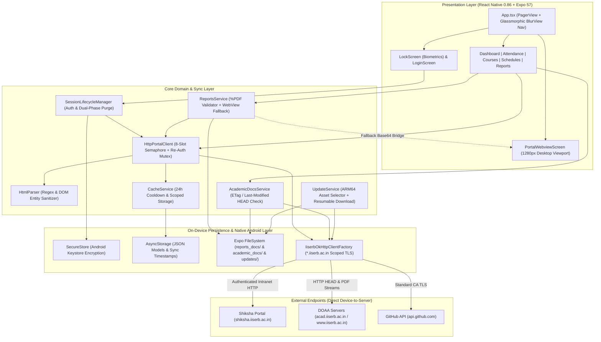

<div align="center">
  

  <h1>Project_S: Shiksha Portal, Reimagined</h1>

  <h3>One native Android app for attendance, grades, courses, and schedules at IISER Bhopal.</h3>

  <p>Check your 75% attendance math, CPI/SPI trends, syllabi, and grade reports in seconds — even completely offline.</p>

  <!-- Badges -->
  <p>
    <a href="https://github.com/abhay-bhagat-319/Project_S/releases/latest"></a>
    <a href="https://github.com/abhay-bhagat-319/Project_S"></a>
    <a href="./LICENSE"></a>
  </p>

  <br />

  <!-- Action Links -->
  <p>
    <a href="https://github.com/abhay-bhagat-319/Project_S/releases/latest"><strong>Download APK</strong></a> · 
    <a href="https://github.com/abhay-bhagat-319/Project_S/releases"><strong>Releases</strong></a> · 
    <a href="https://chat.whatsapp.com/De2Im4U8G6W7spo3YZfZ6B"><strong>WhatsApp Community</strong></a>
  </p>

  <!-- Navigation -->
  <p>
    <a href="https://github.com">Quick Install</a> · 
    <a href="https://github.com">Features</a> · 
    <a href="https://github.com">Why Project_S</a> · 
    <a href="https://github.com">Comparison</a> · 
    <a href="https://github.com">Privacy & Security</a> · 
    <a href="https://github.com">Technical Deep Dive</a> · 
    <a href="https://github.com/abhay-bhagat-319/Project_S/issues">Issues</a>
  </p>

  <!-- Code Snippet -->
  <p><code>git clone https://github.com</code></p>
</div>

<br />


**Project_S** is a free, open-source Android app built for **IISER Bhopal** students. It turns the web-only [Shiksha Portal](shiksha.iiserb.ac.in) and DOAA schedule pages into a clean mobile app—so you can check your attendance, CPI/SPI, course syllabi, grade reports, and exam schedules in seconds, **even without internet**.

## Quick Install (For Students)

1. **Download the APK** from [GitHub Releases](https://github.com/abhay-bhagat-319/Project_S/releases):
   - **Recommended (99% of phones)**: `Project_S-v*-arm64-v8a.apk` (~20 MB)
   - **Older / Other phones**: `Project_S-v*-universal.apk` (~70 MB)
2. **Connect to Campus Wi-Fi or IISERB VPN** and log in once with your LDAP username and password.
3. **Use it anywhere**: Once synced, your dashboard, attendance logs, course info, and downloaded PDFs work **100% offline**.

## Features

- **Instant Offline Dashboard**: Opens straight to your profile, roll number, passed/failed courses, and an interactive **CPI & SPI graph** across semesters—no waiting for pages to load.
- **Smart 75% Attendance Calculator**: Shows your exact attendance percentage and date-wise Present/Absent history for every course, plus automatic class math:
  - **Above 75%**: Tells you exactly how many upcoming classes you can safely skip.
  - **Below 75%**: Tells you how many classes you must attend in a row to get back to 75%.
- **Courses, Syllabi & 1-Tap SRS**: View your registered courses with slot and credit badges, tap **Course Info** to read the full syllabus and textbook list offline, or tap **SRS** to jump straight to your course feedback form.
- **Offline Grade Reports**: Download your official Semester and Cumulative Grade Report PDFs once and open them anytime in your phone's PDF viewer.
- **DOAA Schedules in One Place**: Access Academic Calendars, Class Timetables, Mid/End-Sem Exam Schedules, and Holiday lists inside the app, with automatic checks when DOAA uploads a revised PDF.
- **Built-in Full Shiksha Portal**: Need a feature only on the website? Use the **Portal** tab with smooth desktop zoom and **automatic background login**—no more re-typing your password every time a session expires.
- **1-Tap In-App Updates**: Notifies you when a new version is out, downloads it in the background, and lets you install with a single tap.

## Upcoming Features

- **Personal Weekly Timetable**: Automatic visual class schedule generated from your registered course slots (`A`, `B`, `C`, etc.).
- **Quiz & Exam Marks Breakdown**: View individual quiz, mid-sem, and end-sem scores, weightages, and class averages for each course.

## Why I Built This (Problem & Solution)

### The Problem with the Shiksha Website on Phones
- **Made for Desktops, Not Phones**: Wide HTML tables force you to pinch, zoom, and scroll sideways just to read a single row of attendance.
- **Useless Offline**: Want to check your course slot, textbook, or how many classes you've missed while walking to the lecture hall? If you aren't on Campus Wi-Fi or VPN, the portal won't load.
- **Constant Logouts**: Shiksha logs you out frequently and forces you back to the login screen.
- **Browser Security Warnings**: Intranet certificate errors often block pages or PDFs from opening on mobile browsers.
- **Server Outages**: The server faces severe crashes or outages during peak hours (result release, marks updates, etc.).
- **Scattered PDFs**: Your grade reports are on Shiksha, while exam schedules and academic calendars are buried on separate DOAA web pages.

### How Project_S Solves It
- **Saves Everything on Your Phone**: Syncs your portal data once and stores it locally so the app opens in under a second—even in airplane mode.
- **Logs You Back In Silently**: If your Shiksha session expires while you're on campus Wi-Fi, the app refreshes your session in the background in ~0.2 seconds without interrupting you.
- **Does the Math for You**: Replaces raw numbers with clear 75% attendance targets and visual CPI/SPI charts.
- **Reduces Server Load by ~90%**: Cuts bandwidth consumption on the institute server by fetching only compact data payloads instead of heavy web assets, and only syncs what is needed.
- **Unifies Shiksha + DOAA**: Brings your courses, attendance, grade transcripts, and official DOAA calendars under one roof.

## Benefits Over the Shiksha Portal

| What You're Doing | Shiksha Website (Mobile Browser) | Project_S App |
| :--- | :--- | :--- |
| **Opening the app** | 3–8 seconds per page (needs Wi-Fi/VPN) | **Instant (< 50 ms)**, works offline |
| **Checking attendance** | Raw numbers in wide desktop tables | **75% Skip / Recovery Calculator** + date logs |
| **Session timeouts** | Forces you to re-type LDAP password | **Auto-reconnects silently** + Fingerprint lock |
| **Reading syllabi** | Must log in and click each course online | **Saved offline** with credits, slots & textbooks |
| **Grade reports & schedules** | Re-downloads PDFs every time across 2 websites | **Saved once on phone**, auto-checks for DOAA updates |

## Your Privacy & Security

You log in with your IISERB LDAP credentials, so **Project_S** is built to make sure nobody—including the app developers—can ever see your data:

- **No Backend Server**: Project_S has **zero servers, zero databases, and zero analytics**. Your phone talks directly to IISER Bhopal's official servers (`shiksha.iiserb.ac.in` and `iiserb.ac.in`), just like a web browser.
- **Hardware-Encrypted Password**: Your login details never leave your phone. They are encrypted inside Android's hardware **Keystore** (the same secure chip banking apps use).
- **Fingerprint / Face Lock**: Turn on Biometric Lock in Settings so only you can open your dashboard.
- **Zero Creepy Permissions**: The app **never** asks for your contacts, camera, photos, microphone, or location. It only uses internet access, update notifications, and Android's package installer for in-app updates.
- **100% Open Source**: Every line of code is public in this repository and compiled transparently on GitHub Actions.

## Technical Deep Dive (For Developers)

The sections below cover the internal architecture, networking design, server-load optimizations, and local build setup for developers and contributors.

### System Architecture



#### Key Engineering Highlights

1. **Direct HTTP Sync Engine (`HttpPortalClient.ts`)**:
   - Bypasses headless WebView scraping entirely. Authenticates via `POST /ldap_login_progress`, verifies the hidden `<input id="status" value="ok"/>` token, and fetches `/secure/studenthome`, `/secure/studentMyCourses`, `/secure/studentMyCourseAttendance`, `/secure/courseMoreDetails`, and `/secure/studentReports` directly over native HTTP.
   - Extracts `ng-init` JSON payloads (`initProfileInfo`, `initDiscp`, `initPrformanceRep`, `initReports`) and HTML tables in milliseconds via `HtmlParser.ts`.
2. **Transparent Session Recovery & Mutex (`SessionLifecycleManager.ts`)**:
   - Detects `401/403` statuses, `/login` redirects, or login-form HTML responses mid-request.
   - Uses a single shared in-flight Promise (`reauthPromise`) so concurrent requests trigger only **one** silent re-authentication handshake (~200 ms) before automatically retrying.
3. **Dual-Strategy PDF Downloader (`ReportsService.ts`)**:
   - **Primary Path**: Streams PDFs over authenticated HTTP (`FileSystem.downloadAsync`) in ~250 ms and validates the `%PDF` magic byte header so HTML login redirects are never cached as corrupt files.
   - **Fallback Path**: If an intranet route rejects native cookie forwarding, delegates the fetch to `PortalWebviewScreen` via an injected `FileReader` Base64 bridge (`JVBER` header check).
4. **Domain-Scoped Institutional TLS (`plugins/withIiserbSsl.js`)**:
   - Injects `network_security_config.xml` and registers `IiserbOkHttpClientFactory.kt` in `MainApplication.kt` during `expo prebuild`.
   - Scopes custom `X509ExtendedTrustManager` certificate verification strictly to `*.iiserb.ac.in` hosts while enforcing standard system Certificate Authority checks for all external traffic (`api.github.com`).
5. **Hardware-Accelerated UI (`App.tsx`)**:
   - Keeps all 5 tabs mounted inside a native `PagerView` (`offscreenPageLimit={4}`) to eliminate tab-switch re-renders, paired with a `dimezisBlurView` glassmorphic navigation bar and runtime-recolored Lottie JSON trees (`lottieColor.ts`).

### Security & Permission Audit

| Mechanism / Permission | Implementation Details |
| :--- | :--- |
| `expo-secure-store` | Encrypts `shiksha_username` and `shiksha_password` in the hardware-backed Android Keystore. |
| `expo-local-authentication` | Hardware biometric gate (`LockScreen.tsx`) before loading cached student data into memory. |
| **Dual-Phase Logout Purge** | Wipes `SecureStore`, clears `AsyncStorage` & cached PDFs, sends a `/logout` beacon, and expires WebView cookies across `/`, `/secure`, and `/login`. |
| `INTERNET` & `ACCESS_NETWORK_STATE` | Direct HTTPS requests to `*.iiserb.ac.in` and `api.github.com` + offline state detection. |
| `POST_NOTIFICATIONS` | Local system tray alerts when background APK prefetching completes (`NotificationService.ts`). |
| `REQUEST_INSTALL_PACKAGES` | Launches `android.intent.action.VIEW` to install verified updates from `UpdateService.ts`. |

### How This Reduces IISERB Server Load

During peak periods (exam weeks, grade releases, course registration), hundreds of students refreshing the portal simultaneously strain institutional servers. Project_S reduces server load through five mechanisms:

1. **24-Hour Sync Cooldown (`CacheService.isSyncCooledDown`)**: App launches read exclusively from local storage and only trigger an automatic background sync if $\ge 24\text{ hours}$ have passed since `shiksha_last_sync_time`. Daily attendance/CPI checks generate **zero** server hits.
2. **Targeted Sync Scopes (`SyncScope`)**: Pulling to refresh on a specific tab (`PROFILE`, `ATTENDANCE`, `COURSES`, or `REPORTS`) queries only that endpoint instead of re-fetching the entire portal.
3. **>90% Bandwidth Reduction (No Static Assets)**: A browser reload pulls megabytes of CSS, AngularJS/jQuery bundles, fonts, and images. `HttpPortalClient` fetches only the raw 10–30 KB HTML/JSON response.
4. **8-Slot Concurrency Semaphore (`MAX_CONCURRENT_REQUESTS = 8`)**: Throttles parallel course-detail and attendance requests to prevent PHP/Express session file-lock contention on the Shiksha backend, while coalescing expired-session retries into a single login POST.
5. **Zero-Payload HTTP `HEAD` Revalidation (`AcademicDocsService.ts`)**: Grade reports and DOAA schedules are cached on disk after the first download. Checking for updated DOAA schedules sends lightweight HTTP `HEAD` requests with `If-None-Match` (`ETag`) and `If-Modified-Since` headers—returning a 0-byte `304 Not Modified` response unless a PDF was actually replaced on the server.

### Local Development Setup

**Prerequisites**: Node.js `20+`, JDK `17` (Temurin), and Android SDK (`ANDROID_HOME`).

```bash
# 1. Clone the repository
git clone https://github.com/abhay-bhagat-319/Project_S.git
cd Project_S/mobile

# 2. Install dependencies (automatically runs patch-package for react-native-webview)
npm ci

# 3. Run on a connected Android device or emulator
npx expo run:android
```

**Building Release APKs Locally**:

```bash
npx expo prebuild --platform android --no-install
cd android
# Build targeted ARM64 APK (~20 MB)
./gradlew assembleRelease -PreactNativeArchitectures=arm64-v8a
```

## Call for Contributors

Project_S is built by students, for students. Contributions, bug reports, and UI improvements are always welcome!

### Open Roadmap & Good First Issues
- **Timetable Slot Grid**: Build the interactive weekly timetable screen mapping registered course slots (`A`, `B`, `C`, etc.) to lecture timings.
- **Course Assessment Marks UI**: Connect `CourseMarksModal.tsx` to `/secure/studentCourseMarks` to display quiz, mid-sem, and end-sem component scores and class averages.
- **Parser Resilience**: Expand `HttpPortalClient.ts` and `htmlParser.ts` test coverage for edge-case department syllabus formats.

### Contribution Workflow
1. Fork the [Project\_S repository](https://github.com/abhay-bhagat-319) and create a branch (`git checkout -b feat/your-feature`).
2. Run `npm run typecheck` inside `mobile/` to verify TypeScript compilation.
3. Open a Pull Request with a concise summary and screenshots of any UI changes.

### Community & Links
- **Creator & Lead Maintainer**: [Abhay Bhagat (@abhay-bhagat-319)](https://github.com/abhay-bhagat-319)
- **Issues & Feature Requests**: [GitHub Issues](https://github.com/abhay-bhagat-319/Project_S/issues)
- **Student Feedback & Dev Group**: [Join the WhatsApp Community](https://chat.whatsapp.com/De2Im4U8G6W7spo3YZfZ6B?s=cl&p=a&mlu=4&ilr=4&iam=2)
- **License**: Released under the [MIT License](.%2FLICENSE).
