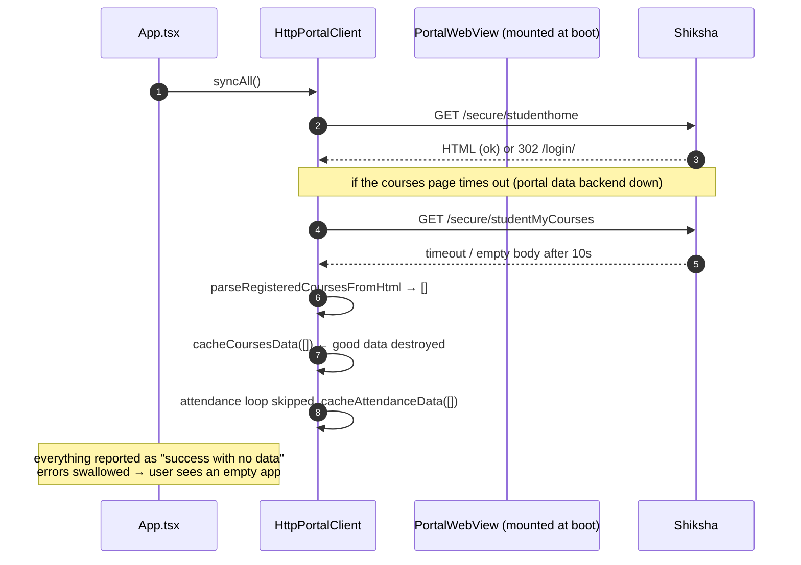
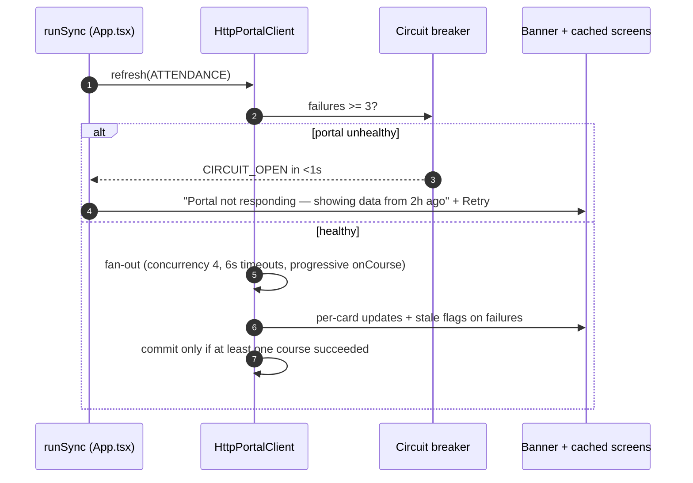

# Diagnosis: Post-Login Sync Failures & Attendance Refresh Optimization

**Target:** `mobile/` (Project_S v1.2.3, RN 0.86 / Expo 57)
**Analysed commit:** `50da185`
**Date:** 2026-10-11
**Symptom under investigation:** Login succeeds reliably. Profile appears *sometimes*. Attendance, Courses and Reports fail to fetch/refresh — the app appears "stuck" on cached (or empty) data beyond the login screen.

> **Note on the referenced HTML:** `docs/portal_pages/` is listed in `.gitignore` and is not present in this checkout, so the parsers could not be validated against the real page markup. Section 5 lists exactly which raw captures are needed to close the remaining gaps. Everything else in this document is derived from the code in this repository plus verified React Native / OkHttp / expo-file-system internals.

---

## 1. TL;DR — the four things that are actually broken

| # | Severity | Issue | Where |
|---|---|---|---|
| **1** | 🟠 P0 *(latent — see §1.1)* | **Two independent login owners fight over a single-session portal.** The HTTP client and the always-mounted Portal WebView both re-authenticate on session expiry. Shiksha enforces one active session per student (the repo's own research documents this), so every login **evicts the other side's session** → the two components repeatedly invalidate each other → every data request lands on `/login/` while "login still works fine". | `HttpPortalClient.recoverSession` (`HttpPortalClient.ts:128`), `PortalWebviewScreen.tsx:66-89` |
| **2** | 🔴 P0 | **One brittle parse aborts the entire sync.** `syncAll()` ran `Promise.all([syncProfile(), syncCourses()])`; `getProfile()` **throws** when its regex misses (`HttpPortalClient.ts:1041`). One miss ⇒ `syncAll` rejects ⇒ attendance, reports and course state are never committed. This is literally "nothing beyond the login screen works". | `HttpPortalClient.ts:1226-1249`, `:1011-1042`, `App.tsx:360-371` |
| **3** | 🟠 P1 | **Empty/failed results silently overwrite good cache.** A parse miss or one bad response returns 0-value records that are persisted and rendered as truth (attendance shows `0 / 0 = 0%`, courses list wipes to `[]`). The old WebView scraper had record-derived fallbacks; the native rewrite dropped them. | `HttpPortalClient.ts:952-962`, `:1000-1008`, `:1216` |
| **4** | 🟠 P1 | **All errors are swallowed.** Every failure path is `console.warn(...)`; `isOffline` is dead state (`App.tsx:70` — `setIsOffline` is never called). The UI cannot distinguish "synced, genuinely empty" from "network/session/parse failure", so failures are invisible and undiagnosable. | `App.tsx:369-371`, `:403-407`, `ReportsService.ts:189-200` |

Fix those four and the app stops being "sometimes working". Sections 3–4 cover improvement and the attendance refresh-rate target.

### 1.1 Field evidence (11 Oct 2026) — and how it shifts the ranking

| Observation from the device | What it rules out / implies |
|---|---|
| Failures happen **on campus Wi-Fi too** (not only off-campus/VPN) | Not a reachability/Fortinet/VPN problem. The failing layer is the app or its contract with the portal, not the network path. |
| On a cold start the **Portal tab WebView already shows the logged-in dashboard** | RN's `fetch` and the WebView share `android.webkit.CookieManager` (verified in RN 0.86.2 source), so if the WebView is authenticated then **the HTTP client's requests are authenticated too**. Session thrashing (P0.1) is therefore **not** the cause of the current always-failing behaviour — it is a latent P0 that fires whenever a session genuinely expires (another device, server-side timeout, logout). |
| "Profile fetches **sometimes**", attendance/courses **always** fail, reports fail | With authentication ruled out, the failure must be in **what the code does with the response**: (a) parsing the wrong thing, (b) a response-contract mismatch, or (c) empty/degraded results overwriting good cache. |

**Prime suspect for the current symptom (before the outage report):** `/secure/studentMyCourses`. The parser (`HttpPortalClient.ts:804-843`) assumes the course rows are **server-rendered `<tr>/<td>` in the initial HTML**. The legacy scraper polled the DOM (`#dataTable tbody tr`) for up to 10 s waiting for rows to appear (`ScraperService.ts:559` attendance scraper, `:816` courses scraper), which is the classic signature of a table AngularJS fills **client-side after an XHR**. If the initial HTML has an empty `<tbody>`, then:

* `parseRegisteredCoursesFromHtml()` returns `[]` → `cacheCoursesData([])` → **Courses tab empty**;
* `syncAttendance()` hits the same `courses.length === 0` branch → **caches an empty attendance list** → Attendance tab empty;
* the profile/reports payloads are `ng-init`-embedded (server-rendered), which explains why profile *sometimes* works and why attendance + courses fail **together**.

### 1.2 Outage evidence (11 Oct 2026, later the same day) — the decisive finding

The portal itself was **down**: `shiksha.iiserb.ac.in` was reachable and the **profile page (`/secure/studenthome`) still rendered**, but **My Courses / attendance / reports pages hang on the website** and eventually time out. That single fact explains the whole symptom set:

| What the portal did | What the app did |
|---|---|
| Served `/secure/studenthome` HTML (server-rendered `ng-init` profile payload) | Profile parsed fine → *"profile sometimes works"* |
| Hung on `/secure/studentMyCourses` (its AngularJS/JSON data backend unavailable) | App waited the full 10 s timeout, got a non-HTML/empty body, parsed **0 courses** → cached an **empty course list** |
| Same backend down for attendance POSTs | Zero courses parsed ⇒ attendance loop never ran ⇒ **empty attendance cached** ("No Attendance Data") |
| Report generation depends on the same backend | Reports list empty/failed ⇒ **"No Grade Reports Found"** |
| Recovered later | The app had already overwritten good cache with empty results ⇒ data did **not** come back until a successful full resync — and nothing told the user why. |

**Conclusions**

1. **The app's biggest bug is not the fetch — it is the failure handling.** Everything that failed was reported as "success with no data", and empty results were persisted over good ones. That is why an outage looked like a permanently broken app rather than a temporary portal problem.
2. The dual-login/session issue (P0.1) and the courses-parser-shape question (§1.1) remain **valid latent defects** to fix, but they are not what broke on the day of the outage.
3. A single-session, intranet-only portal that goes down regularly needs **degraded-mode UX**: keep showing the last good data, state clearly when it was fetched, and fail *fast* instead of hanging for 10 s per request.

### 1.3 Patch 0 — outage resilience (implemented on this branch)

Code changes shipped with this document:

| File | Change |
|---|---|
| `src/services/SyncDiagnostics.ts` *(new)* | Ring buffer (200 events) + AsyncStorage persistence of `{path, status, ms, error code}`. Makes every failure visible in the field and in `adb logcat` under `__DEV__`. |
| `src/components/SyncStatusBanner.tsx` *(new)* | Renders the reason for a failed refresh ("Portal not responding / timed out / session expired / unexpected data") plus the **age of the data on screen** and a Retry button — instead of silently showing stale or empty screens. |
| `HttpPortalClient.ts` | • **Circuit breaker**: 3 consecutive transport failures (timeout/network/5xx) trip a 45 s fast-fail with a single half-open probe, so a pull-to-refresh during an outage returns in **<1 s with a real message** instead of hanging 10 s per request.<br>• **Tolerant attendance normaliser** (`utils/attendanceNormalizer.ts`) — no more hard `status === 'ok'` gate or `?? 0` present count; string counts, alternate keys and record-derived counts all work.<br>• **Never clobber good cache**: an empty course list, an all-failed attendance refresh, or a profile parse miss now throws a typed error and leaves the previous cache intact.<br>• **Per-course merge**: a course that fails to refresh keeps its last known values and is flagged `stale` instead of being written as `0 / 0`.<br>• **`syncAll` uses `Promise.allSettled`** per scope — a profile parse failure can no longer abort courses/attendance/reports.<br>• **Attacks the ping-pong**: re-login is suppressed for 20 s after the last login, and a request never retries against a session that was already refreshed mid-flight.<br>• Concurrency 8 → 4 (PHP session-lock friendly), 6 s per-course timeout, queue watchdog, `X-Requested-With` header, 403 no longer treated as session expiry, no more queue-wipe on transport errors. |
| `CacheService.ts` | Per-scope sync status (`lastSuccessAt`, `lastErrorCode`, …), `attendanceArg` persisted on `Course` (so attendance can safely reuse the cached course list), `stale`/`degraded` fields, and `clearCache()` now removes **all** owned keys (previously leaked the course list + marks across log-out). |
| `App.tsx` | `startSync`/`handleManualRefresh` merged into one `runSync(scope, opts)`; sync errors captured in state and surfaced through the banner; `ALL` only writes state for scopes that succeeded; attendance refresh passes the cached course list so a pull-to-refresh no longer re-downloads `/secure/studentMyCourses`. |
| `AttendanceScreen.tsx` | A course with no data no longer renders as a green **100%** card (that was `calculateAttendance(P, 0)` behaviour); it shows `—` plus an explanation, and a `saved` pill on `stale` courses. |
| `SettingsScreen.tsx` | "Sync Diagnostics" row: portal reachability, failure streak, last 20 events (paths/status/durations only — no cookies or bodies). |
| `tests/attendanceNormalizer.check.ts` *(new)* | 10 assertions covering the envelopes that used to produce fake 0% cards. Run with `npm run check:attendance` (Node 22+). |

**Observable behaviour after Patch 0, with the portal down**

* Login still works (unchanged).
* Profile keeps rendering from cache; courses/attendance/reports keep the last good values instead of emptying.
* The banner reads e.g. *"Portal not responding — showing saved data from 2 h ago"* with a Retry button.
* Pull-to-refresh resolves in under a second while the portal is unreachable (circuit open), and re-probes automatically after 45 s or on the next explicit retry.
* When the portal returns, the next refresh repopulates everything; the diagnostics log shows exactly which scopes failed and when.

**Still open** (needs the HTML/HAR from §5, or a reachable portal): the courses-page data source question (§1.1) and the course-details/marks endpoints.

---

## 2. Issue catalogue (by priority)

### P0.1 — Dual authentication owners cause session thrashing *(latent; PARTIAL: 20 s re-login cooldown + stale-session retry guard landed in Patch 0 — making the WebView passive and unmounting it at boot is still open)*

**Current behaviour**

* `PortalWebviewScreen` is mounted from the very first frame because `PagerView` uses `offscreenPageLimit={4}` (`App.tsx:536`) and it immediately loads `https://shiksha.iiserb.ac.in/secure/studenthome` (`PortalWebviewScreen.tsx:34`).
* On a cold start the session cookie is usually dead server-side. Every HTTP request therefore 302s to `/login/`, and independently the WebView lands on `/login/`.
* The WebView then runs its own re-auth (`PortalWebviewScreen.tsx:75-86`):

```ts
if (navState.url.includes('/login') && !isReauthenticatingRef.current) {
  isReauthenticatingRef.current = true;
  const recovered = await SessionLifecycleManager.silentReauthenticate(); // = full login
  if (recovered) webViewRef.current?.reload();     // ← reloads the /login/ URL again
  ... setTimeout(() => { isReauthenticatingRef.current = false; }, 4000);
}
```

`silentReauthenticate()` → `HttpPortalClient.recoverSession()` → `HttpPortalClient.login()` → **a brand-new PHPSESSID**. Per Shiksha's single-session rule (see `docs/research_session_concurrency_and_ssl_bypass_viability.md` §2.A) that instantly invalidates the session the sync engine is using. `recoverSession()`'s mutex (`reauthPromise`) only covers the *in-flight* window — once it resolves, the next caller starts a **fresh login**. Result:

```
HTTP sync  → login (session A) → request → 302 /login/
WebView    → login (session B, kills A) → reload → lands on /login/ again
HTTP sync  → 302 → login (session C, kills B) → ...
```

In that loop, *login always "works"* (each POST succeeds), which is exactly the reported symptom. The 4-second cooldown plus `reload()` makes it a slow, permanent ping-pong rather than a fast failure.

**Fixes**

1. **One auth owner.** Only `HttpPortalClient` (or `SessionLifecycleManager`) may ever call `login()`. The WebView becomes a passive consumer of the shared cookie jar: on `/login` it may request *"recover once if the session is stale"* and `reload()`, and if that fails it must show a banner ("Session expired — tap to sign in"), never log in itself.
2. **Single-flight + cooldown + generation guard.**

```ts
// HttpPortalClient
private static lastLoginAt = 0;
private static sessionGeneration = 0;
private static readonly LOGIN_COOLDOWN_MS = 20_000;

public static async recoverSession(): Promise<boolean> {
  if (this.reauthPromise) return this.reauthPromise;              // shared in-flight
  if (Date.now() - this.lastLoginAt < this.LOGIN_COOLDOWN_MS) {   // anti-thrash
    console.warn('[HttpPortalClient] Re-auth suppressed (cooldown active).');
    return false;
  }
  this.reauthPromise = (async () => {
    const ok = await this.loginWithStoredCredentials();
    if (ok) { this.lastLoginAt = Date.now(); this.sessionGeneration++; }
    return ok;
  })().finally(() => { this.reauthPromise = null; });
  return this.reauthPromise;
}
```

3. **Stale-retry guard** — never retry a request with a session that was already fresh when the request started (prevents unbounded loops):

```ts
private static async executeRequest<T>(path, options, startedAt = Date.now()) {
  ...
  if (isSessionExpired && !options.isRetry) {
    if (this.lastLoginAt >= startedAt) {
      throw new PortalHttpError('Session invalidated mid-flight', 'SESSION_EXPIRED', ...);
    }
    const recovered = await this.recoverSession();
    if (recovered) return this.executeRequest(path, { ...options, isRetry: true }, startedAt);
  }
}
```

4. **Don't mount the WebView at boot.** Render the Portal tab lazily (mount it on first visit, or set `offscreenPageLimit={1}` and keep a placeholder for tab 3). This removes the boot-time `/secure/studenthome` fetch, ~250 MB of Chromium memory, and most of the session contention.

---

### P0.2 — A single failure aborts the whole sync (`Promise.all` + throwing parser) — [DONE in Patch 0]

```ts
// HttpPortalClient.ts:1234 (before)
const [profile, coursesResult] = await Promise.all([ this.syncProfile(), this.syncCourses() ]);
const attendance = await this.syncAttendance();          // never reached if profile throws
```

`getProfile()` matched with lazy brace-matching regexes (`HttpPortalClient.ts:1016-1018`) plus a document-wide fallback requiring `"roll"` to appear **before** `"name"` (`:1032-1038`). When the markup shifted (escaped quotes, different attribute form, a `<script>` payload instead of `ng-init`), it threw — and because of `Promise.all`, **the entire `ALL` sync died**: no courses, no attendance, no reports, no `lastSyncTime`. `App.tsx:369-371` swallowed the rejection, so the user saw stale content and no error.

**Implemented:** per-scope `Promise.allSettled`, a typed `PARSE_ERROR`, and cache preservation. The balanced-brace extractor below is still worth adopting for the profile/reports `ng-init` payloads:

```ts
/** Balanced-brace extractor — far more robust than /(\{[\s\S]*?\})/ for nested JSON. */
function extractJsonCall(html: string, fnName: string): any | null {
  const start = html.indexOf(fnName + '(');
  if (start === -1) return null;
  const open = html.indexOf('{', start);
  if (open === -1) return null;
  let depth = 0, inStr = false, esc = false;
  for (let i = open; i < html.length; i++) {
    const c = html[i];
    if (inStr) { if (esc) esc = false; else if (c === '\\') esc = true; else if (c === '"') inStr = false; continue; }
    if (c === '"') inStr = true;
    else if (c === '{') depth++;
    else if (c === '}' && --depth === 0) {
      const raw = html.slice(open, i + 1)
        .replace(/&quot;|&#34;/g, '"').replace(/&#39;/g, "'").replace(/&amp;/g, '&');
      try { return JSON.parse(raw); } catch { return null; }
    }
  }
  return null;
}
```

---

### P1.1 — Failed scopes silently clobber good cache — [DONE in Patch 0]

* `syncAttendance()`: if the courses table didn't parse, it **wrote an empty `AttendanceData` and returned it as success** (`HttpPortalClient.ts:952-962`). The Attendance tab then showed "No Attendance Data" even though valid cached records existed a moment ago.
* Per-course catch returned zeros (`HttpPortalClient.ts:1000-1008`) and `Promise.all` then persisted that list (`:1004`), so one flaky course wiped that course's history.
* `syncCourses()` unconditionally `cacheCoursesData(result.courses)` (`:1216`), so a transient 200-with-login-page or a markup change erased the course list.
* `ReportsService.getReports()` filters aggressively (`ReportsService.ts:155-160`) and `syncReports()` returned the cache on failure (`:189-200`) — a silent "No Grade Reports Found".

**Implemented:** empty/degraded results now throw typed errors instead of being persisted, and per-course failures merge the last known values with `stale: true`.

---

### P1.2 — Attendance response contract is stricter than the real endpoint — [DONE in Patch 0]

The old gate:

```ts
if (resJson && resJson.status === 'ok') {                 // ← hard gate
  totalClasses: resJson.totalClasses ?? records.length,
  presentClasses: resJson.presentClasses ?? 0,            // ← always 0 when absent/string
```

`status === 'ok'` was a **hard gate**: `status: "success"`, a missing `status`, or an HTML-ish body ⇒ `{0, 0, []}`. If the server returned counts as **strings** (`"26"`) or under different keys, `presentClasses ?? 0` yielded **0 present with a non-zero total** ⇒ every card rendered `0.0 %` and flagged red. Reproduced locally:

| Response shape | Old WebView scraper | `HttpPortalClient` before Patch 0 |
|---|---|---|
| `{status:'ok', totalClasses:28, presentClasses:26}` | 26/28 ✅ | 26/28 ✅ |
| `{status:'success', totalClasses:28, presentClasses:26}` | 26/28 ✅ | **0/28 ❌** |
| `{totalClasses:28, presentClasses:26}` (no status) | 26/28 ✅ | **0/28 ❌** |
| `{status:'ok', relPresentPercentage:'92.86', userAttendanceInfo:[…]}` | derived from records ✅ | **0 present ❌** (percentage ignored) |

The WebView version also derived counts from the record list and clamped `total` to `records.length` (`ScraperService.ts:714-719`). All of that was dropped in the native rewrite.

**Implemented:** `utils/attendanceNormalizer.ts` (pure, 10 unit checks via `npm run check:attendance`), plus `X-Requested-With: XMLHttpRequest` on the JSON POSTs.

---

### P1.3 — Attendance depends on a cache that may not exist (roll number) — [PARTIAL]

`syncAttendance()` resolved `roll` only from `CacheService.getCachedProfileData()` (`HttpPortalClient.ts:930-938`), with an HTML fallback (`:940-951`). If the profile sync failed *for any reason* — the very failure mode in P0.2 — `roll` was `''` and every attendance POST was sent with `roll: ""`, so the server answered with an error and **every course rendered 0 %**.

**Implemented:** the empty-`roll` case now fails with a clear message ("Missing roll number — sign in again…") and never POSTs an empty roll. **Still open:** persist the roll at login time as first-class state instead of re-deriving it from a page.

Also note `calculateAttendance()` returns `percentage: 100` when `totalClasses === 0` (`utils/AttendanceCalc.ts:6-13`); the Attendance screen now renders `—` plus an explanation for such courses instead of a green 100% card.

---

### P1.4 — Report PDF downloads use a client with no cookie jar and no SSL bypass — [OPEN]

`downloadPdfFile()` (`HttpPortalClient.ts:699-736`) uses `FileSystem.downloadAsync` from **`expo-file-system/legacy`**. That path builds its **own** `OkHttpClient` with timeouts only — no cookie jar, no RN `OkHttpClientProvider` (verified in the installed package: `expo-file-system/android/.../legacy/FileSystemLegacyModule.kt`, `okHttpClient` getter) — and it does **not** go through `IiserbOkHttpClientFactory`. Consequences:

1. Cookies must be injected by hand — the code relies on the single-cookie `activeSessionCookie` captured from `Set-Cookie` (`HttpPortalClient.ts:201-215`), which is fragile.
2. TLS trust depends on `network_security_config.xml` (system + user CAs) rather than the in-app trust manager — on a device without the institute CA installed, the download dies with `SSLHandshakeException` and falls back to the WebView Base64 bridge.

Meanwhile, for normal `fetch()` calls the manual cookie handling (`HttpPortalClient.ts:292-293`) is effectively a no-op: RN's networking module installs `ReactCookieJarContainer` + `ForwardingCookieHandler` (OkHttp jar ⇄ `android.webkit.CookieManager`, shared with the WebView), and OkHttp's `BridgeInterceptor` replaces an explicitly-set `Cookie` header with the jar's cookies ([okhttp#4282](https://github.com/square/okhttp/issues/4282), [okhttp#6316](https://github.com/square/okhttp/issues/6316)).

**Fix:** download PDFs through `fetch()` (jar-backed, factory-backed TLS, gzip, retries) and persist with `FileSystem.writeAsStringAsync(path, base64, { encoding: Base64 })`, or keep `downloadAsync` but obtain the cookie from the shared `CookieManager` via a small bridge. Also note the double registration of `ReportsService.registerPdfDownloader` (`App.tsx:97-108` **and** `PortalWebviewScreen.tsx:45-52`) — the second mount wins; the first's cleanup can unregister the wrong handler.

---

### P1.5 — Concurrency and timeouts are tuned backwards — [PARTIAL]

* `MAX_CONCURRENT_REQUESTS = 8` (`HttpPortalClient.ts:81`) fired at a **PHP session-file-locked** backend: with file sessions, requests sharing a `PHPSESSID` serialise server-side (`docs/research_session_concurrency_and_ssl_bypass_viability.md` §2.D.2). Eight parallel requests therefore queued behind one another *and* each held a client-side slot, so a 7-course attendance fan-out plus profile/courses/reports could exceed the **10 s** timeout (`:74`) on the tail requests — which were then aborted.
* `resetQueue()` (`:116-125`) was called on *any* transport error and released **all** queued waiters at once, defeating throttling exactly when the server was struggling.
* Queued waiters had no watchdog: a slot leak hung every later request forever.
* Retry policy: one immediate retry after a re-login, with no jitter/backoff, no `Retry-After` handling and no distinction between idempotent GETs and POSTs.

**Implemented:** concurrency 4, 6 s per-course timeout, queue watchdog, no queue-wipe, and a transport-failure circuit breaker. **Still open:** per-scope abort controllers and light exponential backoff with jitter for retryable GETs.

---

### P2 — Structural & correctness issues worth fixing in the same pass

1. **UA mismatch (verification needed, high impact if real).** The WebView identifies as *desktop* Chrome (`PortalWebviewScreen.tsx:32`) while `HttpPortalClient` sends an *Android mobile* UA (`:76-77`). If Shiksha serves different markup per UA, the native parsers are being fed a page shape the WebView scrapers never saw. Capture the HTML with the app's exact UA before/after changing it (§5).
2. **`checkSessionExpired` heuristics** (`:220-247`): treated any `401/403` as expiry and substring-sniffed `Please Login`, `User Login`, `name="secret"`, `id="ldap"`. A 403 (permission/CSRF) therefore triggered a pointless full re-login (feeding P0.1). **Partially fixed:** a bare 403 is no longer treated as expiry. The substring heuristics remain.
3. **Global 24 h cooldown for everything** (`CacheService.isSyncCooledDown`, `:217-223`; only `syncAll` wrote `lastSyncTime`). Attendance (daily) and profile (semesterly) deserve per-scope TTLs (attendance 10–15 min, courses 12 h, profile 24 h, reports 6 h). Per-scope `lastSuccessAt`/`isScopeStale` helpers now exist (Patch 0) but only attendance uses them so far.
4. **`CacheService.clearCache()` missed keys** (courses + per-course marks) — **fixed in Patch 0**.
5. **`App.tsx` duplication.** `startSync` and `handleManualRefresh` implemented the same 5-way scope switch twice, with behavioural drift — **fixed in Patch 0** (single `runSync`).
6. **No observability** — **fixed in Patch 0** (diagnostics ring buffer + Settings row). Still open: surfacing the last-sync summary on the main screens.
7. **Dead code obscuring the real architecture:** `ScraperService.ts` is ~1,400 lines of `@deprecated` WebView scripts (only `getPdfDownloadScript` and `getDesktopViewportScript` are still used); `SessionLifecycleManager.registerAdapter/handleWebViewMessage/handleNavigationStateChange/handleLoadEnd/handleAuthError/getSessionCookie/setSessionCookie` have no callers. Delete or quarantine them.
8. **Course details are never fetched.** `getCourses()` only parses the table and merges *cached* details (`:1181-1209`), and nothing populates `courseDetails` any more. So Course Info/credits/slot fall back to the hard-coded `DefaultCourseCatalog` (`utils/courseCatalog.ts`), and the `MARKS` scope + `onRefreshMarks` chain (`App.tsx:350-359`, `:410-421`) is a no-op — `CourseMarksModal` ignores `onRefreshMarks` entirely.
9. **Attendance UI details:** status/date normalisation happens twice, `keyExtractor={item => item.courseCode}` collides if the portal lists a lab + lecture with the same code, and the empty state nests a `ScrollView` with a second `RefreshControl` inside `FlatList`'s `ListEmptyComponent` (`AttendanceScreen.tsx:224-253`). The fake-100% card is fixed in Patch 0.
10. **Security hygiene:** `patches/react-native-webview+13.16.1.patch` calls `handler.proceed()` for **every** SSL error on **every** host (not just `*.iiserb.ac.in`), and `network_security_config.xml` trusts user CAs for **all** domains (`base-config`). Scope both to `iiserb.ac.in` and narrow the patch to the failing-host check that already exists (`error.getUrl()`).

---

## 3. Recommended improvements (ordered roadmap)

**Patch 0 — outage resilience (DONE, see §1.3):** failure-tolerant sync, circuit breaker, cache preservation, tolerant attendance normaliser, error banner, diagnostics log, settings diagnostics row.

**Patch 1 — remaining hardening**

1. ~~`Promise.allSettled` in `syncAll`~~ — done.
2. ~~Never overwrite good cache with empty/degraded results~~ — done.
3. ~~Tolerant attendance normaliser with record-derived counts~~ — done.
4. ~~Error surface: a `syncError` state + dismissible banner showing *why*~~ — done.
5. ~~Diagnostics ring buffer + Settings → "Sync log"~~ — done.
6. Persist `roll` at login as first-class state instead of re-deriving it (P1.3) — **next**.
7. Single auth owner + generation guard; WebView becomes a passive cookie consumer (P0.1) — **next**.
8. Per-card freshness everywhere (partially done for attendance with the `stale` pill).

**Patch 2 — architecture cleanup**

9. One `SyncCoordinator` service owning all scopes; screens only read state.
10. Per-scope TTLs + foreground refresh via `AppState`.
11. Lazy-mount the Portal WebView; drop `offscreenPageLimit` to 1.
12. Per-scope `AbortController`s; typed errors that are *rendered*.
13. PDF download through `fetch` + file write; single cookie source.
14. Remove deprecated `ScraperService` scripts and dead `SessionLifecycleManager` API; add unit tests for every parser with saved HTML fixtures.

**Patch 3 — feature parity**

15. Course details endpoint (`currentCoursesDetail(COURSE_CODE)`) → populate `courseDetails`.
16. Marks endpoint (`getSpreadSheetData` / `studentCourseMarks`) → implement `CourseMarksModal` and the priority-marks streamer.
17. Offline-first polish: per-scope "Updated X min ago" chips (attendance has one now).

---

## 4. Optimizing the attendance refresh rate

### 4.1 Where the time actually goes today

`handleManualRefresh('ATTENDANCE')` → `syncAttendance()`:

| Step | Requests | Notes |
|---|---|---|
| `GET /secure/studentMyCourses` | 1 | Full HTML page (Angular + Materialize bundle links), 100–400 KB, purely to re-derive a course list that is already cached |
| `POST /secure/studentMyCourseAttendance` × N | N (6–9) | Serialised server-side by the PHP session lock; client cap 8; 10 s timeout each |
| Possible `login` (302 → recover → retry) | +1…+2 | ~0.7–2.5 s, and it invalidates the WebView session |
| **Total** | **8–12** | Typically **2.5–6 s**, worst case 10 s+ (timeout) |

### 4.2 Target design

```
pull-to-refresh (ATTENDANCE)
        │
        ├─ 0 ms   render cache immediately (already done) + show "refreshing" per card
        ├─ 0 ms   use the cached course list + cached roll  (no /studentMyCourses fetch unless stale >12 h)
        ├─ 0 ms   single-flight guard: if a refresh is in flight, return the same promise
        ├─ ~50 ms fire N POSTs with concurrency 4, timeout 6 s, X-Requested-With
        ├─ ~200-400 ms  first response → onCourse(item) → that card re-renders immediately
        ├─ ~400-900 ms  all responses → merge (allSettled), persist, mark stale courses
        └─ 0 ms   never re-login unless the server said /login (cooldown + single flight)
```

Expected: **~0.4–0.9 s** warm refresh (from 2.5–6 s), first card in **<400 ms**, and **zero** extra logins. During an outage: <1 s fast-fail with an explanation.

**Landed in Patch 0:** cached course list reuse (when `attendanceArg` is present), concurrency 4, 6 s timeouts, progressive `onCourse` delivery, per-course `stale` merge, no cache clobbering, circuit breaker.

**Still to do:** single-flight guard, per-scope abort, ETag revalidation, background warm-up, per-scope TTLs.

### 4.3 Remaining concrete changes

1. **Single-flight + abort.** A module-level `attendanceSyncPromise`; return it if a refresh is already running. Abort on screen blur / new refresh with an `AbortController` so stale responses cannot overwrite newer state.
2. **Investigate the single-request aggregation endpoint.** `docs/research_portal_sync_speedup_and_targeted_refresh.md` mentions `/secure/getStudentAttendanceRecord`, and the course table also exposes `getSpreadSheetData(courseCode)`; the Angular controller may already hold per-course attendance in scope. If any endpoint returns **all courses in one response**, the fan-out disappears: attendance refresh becomes a single ~150 ms request. Verify from the saved HTML/HAR and prefer it.
3. **Warm the connection.** Fire a cheap `GET /secure/studentMyCourses` in the background on app foreground so the TLS handshake and PHP session are hot.
4. **Revalidate cheaply when the portal supports it.** If the attendance endpoint emits `ETag`/`Last-Modified`, store them per course and send `If-None-Match`/`If-Modified-Since`; a `304` costs one round trip instead of a full JSON body.
5. **Refresh triggers:** pull-to-refresh; on foreground if `now - fetchedAt > 15 min`; optionally `expo-background-task` while on campus Wi-Fi (gate on connectivity, not a generic network state machine — consistent with ADR 0002).
6. **UX:** per-card freshness (`Updated 2 min ago`), stale chips (done for attendance), per-scope spinners instead of a global one, list stays interactive during refresh.
7. **Instrument it:** the diagnostics log now records `{scope, ms, failures}` per sync — extend to `{concurrency, firstResponseMs, bytes, reauths}`.

### 4.4 What "best possible" looks like

| Metric | Before | After Patch 0 | Target (Patch 2) |
|---|---|---|---|
| Requests per attendance refresh | 8–12 | 6–9 (1 fewer page fetch) | **1** if an aggregate endpoint exists |
| Warm refresh wall clock | 2.5–6 s (up to 10 s+) | 1.2–3 s | 0.4–0.9 s |
| Time to first updated card | = full refresh | < 400 ms | < 400 ms |
| Outage behaviour | 10 s hang per request, empty cache | < 1 s fast-fail + banner + cache kept | same |
| Extra logins per refresh | 0–2 (thrashing) | 0 (cooldown + stale-retry guard) | 0 |

---

## 5. What is needed to finish the parser work

The parsers are written against saved page HTML that is git-ignored and absent here. To close the loop, please provide (sanitised) raw captures:

1. `GET /secure/studenthome` → the `<body ng-init>` fragment (or the whole file). *Need:* exact `initProfileInfo` / `initDiscp` / `initPrformanceRep` call shape and quoting.
2. `GET /secure/studentMyCourses` → the `#dataTable` markup (header row + one data row). *Need:* column order, whether rows are server-rendered or Angular-injected, the exact `ng-click="getAttendanceData('…')"` argument form. **This is the one that decides §1.1.**
3. `GET /secure/studentReports` → the `initReports([...])` fragment. *Need:* whether `file` is a URL or an id, and whether `fetchFile(...)` must be called first to generate the PDF.
4. `POST /secure/studentMyCourseAttendance` → request **and** response, plus response headers. *Need:* the real status/count key names and types, and whether `X-Requested-With`/`Content-Type` changes the answer.
5. Login `POST /ldap_login_progress` → response headers only (`Set-Cookie` **names** and attributes, not values). *Need:* confirm the session cookie name (`PHPSESSID` vs `ci_session`) and whether more than one cookie is issued.

**Capture recipe (no code changes needed):**

1. On a laptop connected to **campus Wi-Fi or the IISERB VPN**, log into `https://shiksha.iiserb.ac.in` in Chrome/Edge.
2. For each page (`/secure/studenthome`, `/secure/studentMyCourses`, `/secure/studentReports`): press **Ctrl+U** ("View page source" — *not* the DevTools Elements panel, which shows the post-Angular DOM) and save the file.
3. Open **DevTools → Network**, tick "Preserve log" and "Disable cache", then on the My Courses page click the **attendance icon** for one course and open the "Course Info" popup. Export the whole session as a **HAR** (Network panel → ↓ Export HAR). Bodies are included; strip the `Cookie`/`Authorization` values before sharing.
4. I only need: header **names**, status codes, URLs, and response bodies.
5. Drop the files into `docs/portal_pages/` (already git-ignored, so nothing becomes public) or attach them here.

> **Do not wait for the portal to be stable to send these.** Even a partial capture — the My Courses *source* view taken during a slow load — settles §1.1. And the new **Settings → Sync Diagnostics** log records what the app actually received during an outage (paths, status codes, durations), which is exactly the evidence needed to confirm §1.2 in the field.

Alternative if you only have the phone: add a `__DEV__`-only dump in `executeRequest` that writes `rawText` to `FileSystem.documentDirectory + 'capture_' + <sanitised path> + '.html'`, reproduce each screen once, and `adb pull` the files. I can write that patch in ~20 lines if you want it.

---

## Appendix A — Verified platform facts used above

| Claim | Verification |
|---|---|
| RN `fetch` shares cookies with `react-native-webview` via `android.webkit.CookieManager` | `NetworkingModule.kt` (RN 0.86.2): `ForwardingCookieHandler`, `cookieJarContainer?.setCookieJar(JavaNetCookieJar(cookieHandler))`; `OkHttpClientProvider.createClientBuilder()` sets `.cookieJar(ReactCookieJarContainer())` |
| An explicitly set `Cookie` header is **replaced** by the jar's cookies | okhttp issues [#4282](https://github.com/square/okhttp/issues/4282), [#6316](https://github.com/square/okhttp/issues/6316) (BridgeInterceptor `requestBuilder.header("Cookie", …)`) |
| `expo-file-system/legacy` `downloadAsync` uses its own OkHttp client (no cookie jar, no custom trust manager) | `expo-file-system@57.0.6`, `android/src/main/java/expo/modules/filesystem/legacy/FileSystemLegacyModule.kt` → `okHttpClient` builds `OkHttpClient.Builder().connectTimeout(60s)…` with no `cookieJar` |
| Parser behaviour regressions (verified by extracting the repo's own regexes and running them in Node) | `initProfileInfo` extraction works for plain / single-quoted / `&quot;`-escaped JSON, **fails** for `initProfileInfo(&quot;{…}&quot;)` and for non-`ng-init` payloads; the attendance gate `status === 'ok'` plus `presentClasses ?? 0` maps `{status:'success', totalClasses:28, presentClasses:26}` → **0/28** and `{status:'ok', relPresentPercentage:'92.86', userAttendanceInfo:[…]}` → **0 %** |
| The normaliser in Patch 0 handles those shapes | `npm run check:attendance` → 10/10 assertions pass (`tests/attendanceNormalizer.check.ts`) |

## Appendix B — Current request flow (before Patch 0)



With Patch 0 applied:


