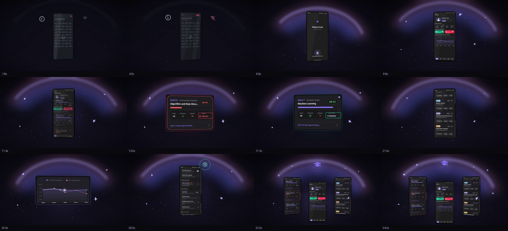

# Shiksha Portal — promo film

A **36-second, 1920×1080, 60 fps, silent, text-free** product film for the
Project_S / Shiksha Portal Android app, rendered entirely in code (Pillow + numpy
→ ffmpeg). No stock footage, no After Effects, no audio — the visuals are generated
frame-by-frame from the app's own screenshots so they stay pixel-accurate.

The visual language is inspired by the Zelios "Doks.AI" spot: a dark stage, a glowing
aurora arc, a perspective grid floor, chrome four-point sparkles, and UI that floats
in 2.5D perspective with smooth eased camera moves. It is re-skinned in the app's
purple brand palette (`#8B7CF8`).



## Story (student problems → the app)

| Time | Beat | What it shows |
|------|------|---------------|
| 0–6  | The struggle | A clunky web portal: endless spinner, piling notification badges, a fast-spinning clock (lost time), wifi cutting out. Desaturated, uneasy. |
| 6–11 | Unlock | Purple aurora blooms; the phone rises, fingerprint ripples, biometric unlock bursts into the live dashboard. |
| 11–20 | Attendance math | The list scrolls, then the low-attendance card **lifts out** as a floating panel — *"Need 26 classes"* pulses red — followed by the healthy card, *"Can Miss 4 classes"* in green. The 75% rule, made obvious. |
| 20–27 | Courses & CPI | Colourful course cards scroll; the CPI/SPI trend graph lifts out and the CPI line **draws itself** with a glowing sweep. |
| 27–31 | Offline & private | Wifi-off icon, then a green check — the settings screen keeps scrolling. Works without internet. |
| 31–36 | Finale | Three screens fan out under the aurora; the mortarboard logo settles; slow push-in; fade to black. |

No words are added anywhere — meaning is carried by the real UI, motion, colour and
iconography. Sound is intentionally left out so it can be scored later.

## Render

```bash
cd promo
python3 -m venv .venv
.venv/bin/pip install -r requirements.txt

# Full film (≈15 min on 2 cores) -> out/shiksha_portal_promo.mp4
.venv/bin/python render.py --jobs 2

# Preview stills at specific times (fast iteration)
.venv/bin/python render.py --frames 2.5,14.5,25.5,33.5

# A short clip, e.g. the attendance hero
.venv/bin/python render.py --clip 13 19 --out out/attendance.mp4

# Quick low-res draft (30 fps, no supersampling)
.venv/bin/python render.py --draft --jobs 2
```

Output: H.264, `yuv420p`, CRF 17, `+faststart`, **no audio track**.

## Files

- `engine.py` — the mini motion-graphics engine: easing/keyframe tracks, perspective
  warp, aurora/grid/dust background, chrome sparkle sprite, vector icons, camera.
- `render.py` — asset prep (watermark removal, status-bar pinning, CPI line
  extraction), the phone device, screen-space effects, floating panels, the full
  storyboard, and the parallel ffmpeg pipeline.
- `assets/` — the app screenshots used as source material.
- `out/` — rendered video (git-ignored).
- `preview/` — preview stills (git-ignored).

## Tuning

The whole film is keyframed in `render.py` (search for `Track(`). Scene timing,
camera zoom (`ZOOM`), phone motion (`AP_YAW`, `AP_SCALE`, …), scroll positions
(`ATT_SCROLL`, `CO_SCROLL`, `SE_SCROLL`) and the aurora (`AURORA_I`, `AURORA_HUE`)
are all plain numeric tracks — edit the numbers and re-render. Colours live at the
top of `engine.py` (`PURPLE`, `INDIGO`, `PINK`, `GREEN`, `RED`).
